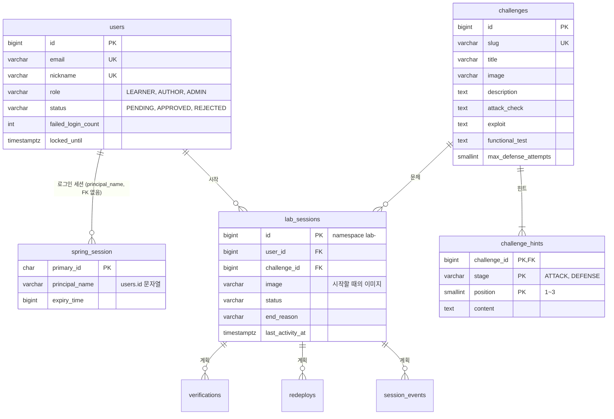

# 데이터 모델

플랫폼 DB의 테이블과 관계를 한 장으로 본다. 무엇을 저장해야 하는지는 [product.md](product.md) "데이터 모델 (개념)"에, 컬럼과 제약을 정한 이유는 각 ADR에 있다. 테이블이나 관계가 바뀌면 migration 작업과 같은 때 이 문서를 고친다.

## 관계도

관계도에는 관계를 이해하는 데 필요한 컬럼만 적었다. 전체 컬럼은 정한 곳의 ADR과 migration에 있다.

## 테이블

| 테이블 | 상태 | 정한 곳 |
|---|---|---|
| `users` | 구현됨 (be migration V2, V3) | [ADR 011](decisions/011-계정-규칙.md) |
| `spring_session`, `spring_session_attributes` | 구현됨 (be migration V1) | [ADR 002](decisions/002-인증-방식.md), [ADR 010](decisions/010-db-postgresql-flyway.md) |
| `challenges` | 구현됨 (be migration V4, V7) | [ADR 012](decisions/012-실습-환경-수명-주기.md), [ADR 014](decisions/014-challenge-형식과-등록.md) |
| `challenge_hints` | 구현됨 (be migration V7) | [ADR 014](decisions/014-challenge-형식과-등록.md) |
| `lab_sessions` | 구현됨 (be migration V5) | [ADR 012](decisions/012-실습-환경-수명-주기.md) |
| `verifications` | 계획. product.md의 Verification | #9 공격 검증과 단계별 힌트, #11 방어 검증 |
| `redeploys` | 계획. product.md의 Redeploy | #10 방어: 웹 IDE, 재빌드·재배포, 초기화 |
| `session_events` | 계획. product.md의 SessionEvent | #13 관리와 기록 |

- `spring_session.principal_name`은 `users.id`를 문자열로 담지만 FK가 아님. 역할 변경, 임시 비밀번호 발급, 탈퇴 때 앱이나 runbook이 직접 지움
- `lab_sessions.user_id`는 `ON DELETE CASCADE`, `lab_sessions.challenge_id`는 `ON DELETE RESTRICT`
- `challenge_hints.challenge_id`는 `ON DELETE CASCADE`. 문제마다 공격 힌트 3개, 방어 힌트 3개
- 계획인 테이블의 이름과 관계는 product.md 개념에서 옮긴 것이고, 그 이슈를 설계할 때 정함
- product.md의 LabSession 개념 중 공개한 힌트 수, 공격 건너뜀 여부, 방어 검증 시도 횟수는 #9, #11에서 `lab_sessions` 컬럼으로 추가함
